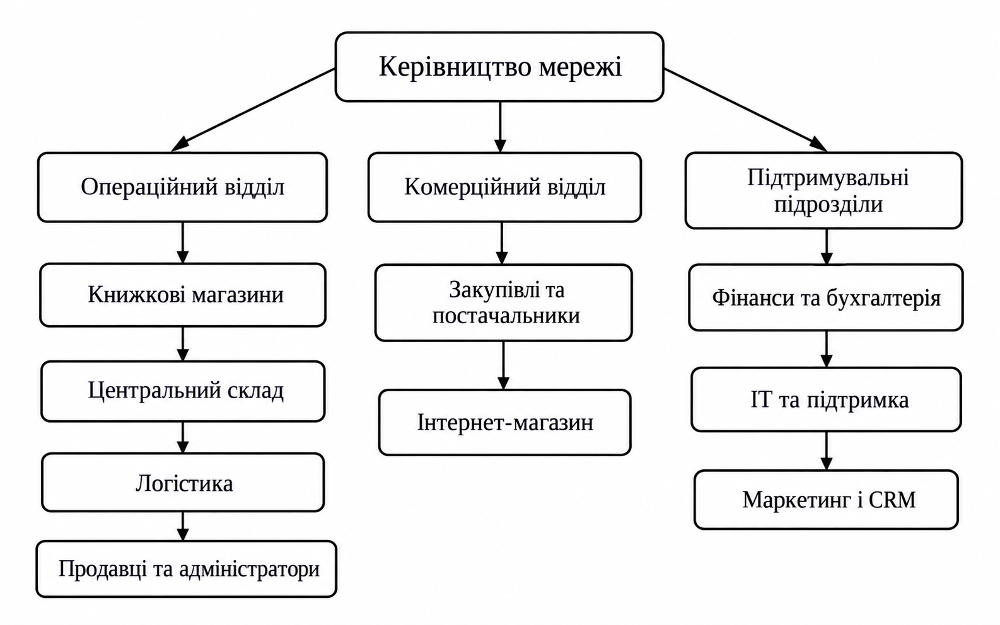
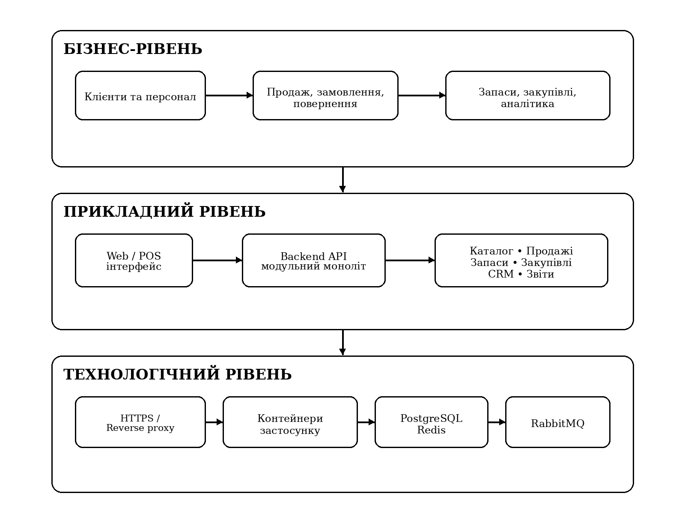
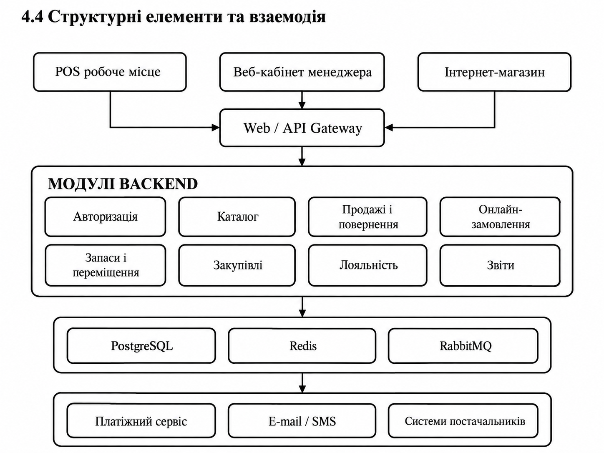
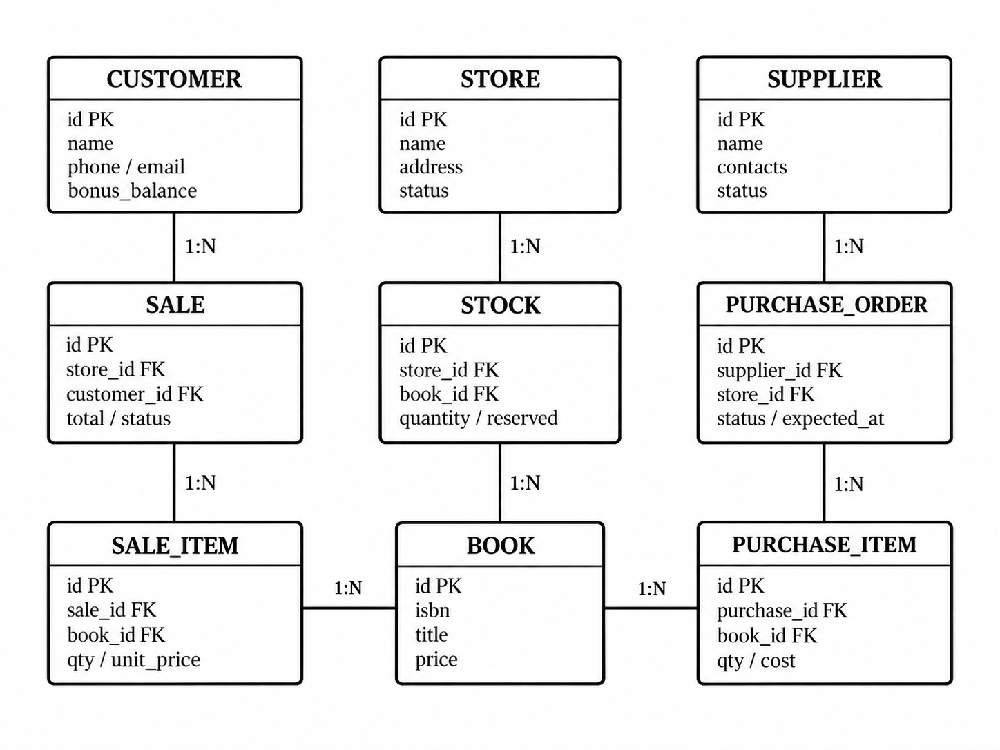

Міністерство освіти і науки України
Національний технічний університет України
«Київський політехнічний інститут імені Ігоря Сікорського»
Факультет інформатики та обчислювальної техніки
Кафедра інформаційних систем та технологій

**ЗВІТ
**з комп’ютерного практикуму з дисципліни
«Проектування і розроблення інформаційних систем та технологій»

на тему
**«Типова інформаційна система мережі книжкових магазинів»**

Виконали студенти:
ІК-61мп Гладишев Андрій
ІС-62мп Решетняк Катерина
ІС-62мп Решетняк Сергій

Київ 2026

ЗМІСТ

[ВСТУП 5](#_Toc242382243)

[1\. АНАЛІЗ ПРЕДМЕТНОЇ ОБЛАСТІ ІНФОРМАЦІЙНОЇ СИСТЕМИ 7](#_Toc242382244)

[1.1 Мета проєкту 7](#_Toc242382245)

[1.2 Опис проблеми, проектні припущення, обсяг продукту 8](#_Toc242382246)

[1.2.2 Проектні припущення 9](#_Toc242382247)

[1.2.3 Обсяг продукту 11](#_Toc242382248)

[1.3 Характеристика користувачів 12](#_Toc242382249)

[1.4 Опис організації 14](#_Toc242382250)

[1.4.1 Структура та підрозділи 14](#_Toc242382251)

[1.4.2 Зацікавлені сторони та користувачі системи 15](#_Toc242382252)

[2\. ЗАГАЛЬНА ТЕХНІЧНА СПЕЦИФІКАЦІЯ 17](#_Toc242382253)

[2.1 Специфікація вимог 17](#_Toc242382254)

[2.1.1 Основні функції продукту 17](#_Toc242382255)

[2.1.2 Функціональні вимоги 18](#_Toc242382256)

[2.1.3 Нефункціональні вимоги 21](#_Toc242382257)

[2.2 Технічні специфікації для бізнесу 23](#_Toc242382258)

[2.2.1 Бізнес-цілі 23](#_Toc242382259)

[2.2.2 Аналіз обмежень 24](#_Toc242382260)

[2.2.3 Аналіз ризиків 26](#_Toc242382261)

[2.2.4 Продукти та послуги 28](#_Toc242382262)

[3\. СЦЕНАРІЇ КОРИСТУВАЧА 30](#_Toc242382263)

[3.1 Вхід до системи 30](#_Toc242382264)

[3.2 Додавання нової книги 30](#_Toc242382265)

[3.3 Редагування ціни 31](#_Toc242382266)

[3.4 Видалення або деактивація книги 31](#_Toc242382267)

[3.5 Оформлення продажу 31](#_Toc242382268)

[3.6 Повернення товару 32](#_Toc242382269)

[3.7 Переміщення між магазинами 32](#_Toc242382270)

[3.8 Онлайн-замовлення і зміна статусу 32](#_Toc242382271)

[3.9 Приймання поставки 33](#_Toc242382272)

[3.10 Перегляд історії змін 33](#_Toc242382273)

[3.11 Відображення інформації про статус 34](#_Toc242382274)

[3.12 Формування управлінського звіту 34](#_Toc242382275)

[4\. АРХІТЕКТУРА ПРОДУКТУ 35](#_Toc242382276)

[4.1 Варіанти архітектури 35](#_Toc242382277)

[4.1.1 Класична монолітна архітектура 35](#_Toc242382278)

[4.1.2 Мікросервісна архітектура 35](#_Toc242382279)

[4.1.3 Модульний моноліт з подієвими інтеграціями 36](#_Toc242382280)

[4.2 Порівняння та вибір архітектури 36](#_Toc242382281)

[4.3 Архітектура за рівнями 38](#_Toc242382282)

[4.4 Структурні елементи та взаємодія 39](#_Toc242382283)

[4.5 Технології та засоби 41](#_Toc242382284)

[4.6 Підтримка бази даних 43](#_Toc242382285)

# ВСТУП

Сьогодні книжкові магазини працюють із великою кількістю товарів, постачальників і замовлень, тому організація їхньої роботи потребує належного обліку та контролю. Особливо це стосується мереж книжкових магазинів, де необхідно відстежувати залишки книг у різних торгових точках, контролювати продажі, організовувати поставки та переміщення товарів між магазинами. Використання окремих таблиць або програм для виконання цих завдань не завжди є зручним, оскільки інформація може дублюватися, а дані про наявність товарів — відрізнятися від фактичних.

Для ефективної роботи мережі важливо, щоб працівники мали швидкий доступ до актуальної інформації про книги, їхню вартість і кількість у кожному магазині. Це дозволяє швидше обслуговувати покупців, оформлювати замовлення, резервування та повернення товарів. Водночас керівництву необхідно аналізувати продажі, визначати найбільш популярні видання, контролювати товарні запаси та планувати закупівлі. Тому використання єдиної інформаційної системи може значно спростити виконання повсякденних завдань і зменшити кількість помилок, пов'язаних із ручним веденням обліку.

Актуальність обраної теми полягає в необхідності автоматизації основних процесів роботи мережі книжкових магазинів. Єдина інформаційна система дозволить об'єднати дані про асортимент, продажі, замовлення, постачальників і клієнтів, а також забезпечити зручне управління цими даними. Завдяки цьому працівники зможуть витрачати менше часу на перевірку інформації, а керівництво – отримувати необхідні відомості для прийняття рішень.

Метою роботи є аналіз предметної області та проєктування типової інформаційної системи для мережі книжкових магазинів. У межах роботи розглядаються організаційна структура мережі, основні категорії користувачів, їхні потреби та завдання, які повинна виконувати система. Також визначаються функціональні й нефункціональні вимоги, бізнес-цілі, обмеження та можливі ризики. Окремо розглядаються основні сценарії використання системи й можливі підходи до побудови її архітектури. На основі їх порівняння обирається архітектурне рішення, яке відповідатиме потребам мережі книжкових магазинів і буде зручним для подальшого розвитку та підтримки.

# 1. АНАЛІЗ ПРЕДМЕТНОЇ ОБЛАСТІ ІНФОРМАЦІЙНОЇ СИСТЕМИ

Перед проєктуванням системи потрібно чітко розуміти, які процеси вона повинна підтримувати. У мережі книжкових магазинів між собою пов’язані торгівля, складський облік, закупівлі, робота з клієнтами та аналітика. Помилка в одному з цих процесів майже одразу впливає на інші. Наприклад, неправильно проведене надходження призводить до хибного залишку, а це вже впливає на продаж у магазині та доступність товару для онлайн-замовлення.

## 1.1 Мета проєкту

Метою проєкту є розробка типової інформаційної системи для мережі книжкових магазинів, яка дозволить об’єднати основні процеси роботи магазинів, центрального складу та адміністративних підрозділів.

Система призначена для централізованого зберігання та обробки інформації про книги, ціни, товарні залишки, замовлення й клієнтів. Її впровадження допоможе зменшити кількість ручних операцій, уникнути дублювання даних, прискорити обслуговування покупців і спростити управління товарними запасами.

Для досягнення поставленої мети необхідно реалізувати такі завдання:

- створити єдиний каталог книг, який міститиме ISBN, назву, автора, видавництво, жанр, ціну та інші характеристики видань;
- забезпечити облік товарних залишків у кожному магазині та на центральному складі;
- автоматизувати процеси продажу, повернення, резервування книг та обробки онлайн-замовлень;
- реалізувати можливість обліку переміщень товарів між магазинами та складом;
- спростити оформлення закупівель, роботу з постачальниками та контроль надходження товарів;
- створити базу клієнтів із можливістю використання програми лояльності;
- забезпечити формування звітів про продажі, залишки товарів, їхню оборотність та результати роботи

## 1.2 Опис проблеми, проектні припущення, обсяг продукту

У мережі книжкових магазинів щодня відбувається велика кількість операцій, пов’язаних із продажем, резервуванням, поверненням і переміщенням книг між торговими точками та складом. Кожна з цих операцій впливає на кількість доступних товарів, тому важливо своєчасно оновлювати інформацію в системі. Якщо дані оновлюються із затримкою або вносяться вручну, можуть виникати розбіжності між фактичною кількістю книг та інформацією в обліку.

Однією з основних проблем є використання різних програм і способів ведення обліку в окремих магазинах. Наприклад, інформація про продажі може зберігатися в касовій програмі, залишки товарів — у таблицях Excel, а дані про закупівлі ⎯ у бухгалтерській системі. Через відсутність єдиної бази даних працівникам доводиться перевіряти інформацію в кількох джерелах, що займає додатковий час і збільшує ймовірність помилок.

Основними проблемами, які виникають під час роботи мережі книжкових магазинів, є:

- невідповідність фактичних залишків книг даним, зазначеним в облікових системах;
- тривалий пошук інформації про книги та перевірка їх наявності в інших магазинах мережі;
- необхідність вручну формувати замовлення постачальникам без достатнього аналізу попередніх продажів;
- нерівномірний розподіл товарів між магазинами, через що в одних торгових точках виникає надлишок певних книг, а в інших — їх нестача;
- складність відстеження резервувань, онлайн-замовлень і повернень товарів;
- відсутність єдиної історії змін цін, товарних залишків і статусів замовлень;
- затримки у формуванні звітів через необхідність збирати та перевіряти дані з різних джерел;
- недостатнє розмежування прав доступу працівників до фінансової інформації та персональних даних клієнтів.

Перелічені проблеми впливають не лише на внутрішню організацію роботи магазинів, а й на якість обслуговування покупців. Наприклад, клієнт може побачити на сайті інформацію про наявність книги, але під час відвідування магазину виявиться, що її вже продано. Також можуть виникати затримки з підтвердженням онлайн-замовлень або труднощі з пошуком потрібного видання в інших торгових точках.

Таким чином, основна проблема полягає у відсутності централізованої системи, яка дозволяла б своєчасно оновлювати дані та контролювати основні процеси роботи всієї мережі. Розробка такої інформаційної системи допоможе забезпечити точніший облік товарів, спростити роботу працівників і підвищити якість обслуговування покупців..

### 1.2.2 Проектні припущення

Під час проєктування інформаційної системи необхідно врахувати особливості роботи мережі книжкових магазинів та умови її використання. Оскільки система розробляється як типове рішення, вона повинна підходити для різних книжкових мереж, а не лише для одного конкретного підприємства.

Для визначення основних вимог до системи було прийнято такі припущення:

- мережа книжкових магазинів складається з центрального офісу, складу та кількох торгових точок, які працюють у межах спільної системи;
- усі магазини мають доступ до Інтернету, проте допускається можливість тимчасових перебоїв зі з'єднанням;
- для ідентифікації книг використовується ISBN, але система також повинна підтримувати облік інших товарів, які не мають ISBN, наприклад канцелярських товарів або подарункових наборів;
- працівники користуються системою через вебінтерфейс, а для касирів передбачається окремий режим роботи, пристосований для швидкого оформлення продажів;
- фізичні магазини та інтернет-магазин використовують спільний каталог товарів, інформацію про ціни та їхню наявність;
- оплата банківськими картками здійснюється через зовнішній платіжний сервіс, тому система не зберігає платіжні реквізити клієнтів;
- для ведення бухгалтерського обліку може використовуватися окрема програма, з якою система обмінюватиметься необхідними даними через API або файли;
- у майбутньому мережа може розширюватися, тому система повинна дозволяти додавати нові магазини без необхідності змінювати програмний код.

Наведені припущення дозволяють визначити основні умови роботи інформаційної системи та врахувати можливості її подальшого розвитку. Вони також є основою для формування функціональних і нефункціональних вимог, які розглядатимуться в наступних розділах роботи.

### 1.2.3 Обсяг продукту

Розроблювана інформаційна система являє собою вебзастосунок, призначений для автоматизації основних процесів роботи мережі книжкових магазинів. Системою користуватимуться як працівники магазинів, складу та адміністративних підрозділів, так і покупці через інтернет-магазин. Перша версія продукту повинна містити основні функції, необхідні для повсякденної роботи мережі.

До функціональних можливостей системи входять:

- ведення єдиного каталогу книг з інформацією про авторів, видавництва, категорії та постачальників;
- облік магазинів, складів і товарних залишків у кожній торговій точці;
- реєстрація надходжень товарів, проведення інвентаризації та списання книг;
- оформлення й відстеження переміщень товарів між магазинами та центральним складом;
- здійснення роздрібних продажів, формування чеків, оформлення повернень і скасування операцій з урахуванням прав доступу працівників;
- обробка онлайн-замовлень, резервування книг та відстеження статусу замовлення;
- ведення клієнтської бази, нарахування бонусів і застосування персональних знижок;
- створення замовлень постачальникам та контроль їх виконання;
- формування звітів про продажі, товарні залишки, закупівлі та результати роботи магазинів;
- управління обліковими записами користувачів, їхніми ролями та правами доступу;
- збереження історії важливих операцій і змін у системі для подальшого перегляду та контролю.

Водночас перша версія системи не передбачає реалізації всіх процесів, які можуть бути пов'язані з діяльністю книжкової мережі. Зокрема, до її функціональності не входять повноцінний бухгалтерський і кадровий облік, розробка власної системи обробки банківських платежів, управління маршрутами кур'єрської доставки та функції видавничої платформи.

Для виконання таких завдань можуть використовуватися сторонні сервіси та спеціалізовані програми. За потреби система повинна підтримувати можливість обміну даними з ними.

Таким чином, основна увага під час розробки приділяється функціям, які безпосередньо пов'язані з продажем книг, управлінням товарними запасами, обробкою замовлень і контролем роботи магазинів. Такий підхід дозволяє зосередитися на найбільш важливих завданнях і залишити можливість для подальшого розширення системи.

## 1.3 Характеристика користувачів

Користувачі відрізняються не тільки набором прав, а й тим, як часто і в яких умовах вони працюють із системою. Для продавця важлива швидкість дій під час обслуговування черги. Для комірника важливі точність і зручна робота зі сканером штрих-кодів. Для менеджера важливі контроль і звіти. Тому інтерфейс і права доступу мають враховувати конкретну роль.

Таблиця 1.1 - Характеристика основних користувачів

| **Роль** | **Основні дії** | **Ключові потреби** |
| --- | --- | --- |
| Покупець | Шукає книги, переглядає наявність, оформлює онлайн-замовлення, отримує інформацію про статус і бонуси. | Простий інтерфейс, актуальні залишки, швидке оформлення замовлення. |
| Продавець-касир | Проводить продаж, резерв, повернення, перевіряє наявність у мережі, працює з карткою клієнта. | Мінімум зайвих полів, швидкий пошук, робота зі штрих-кодом. |
| Адміністратор магазину | Контролює зміни, локальні залишки, інвентаризації, переміщення та складні операції повернення. | Розширені права в межах свого магазину, локальні звіти. |
| Комірник | Приймає поставки, формує відвантаження, переміщення, списання та інвентаризації. | Точність кількості, сканування, зрозумілі статуси документів. |
| Менеджер із закупівель | Створює замовлення постачальникам, контролює терміни та закупівельні ціни. | Прогноз потреби, історія закупівель, контроль невиконаних поставок. |
| Маркетолог / CRM-менеджер | Створює акції, сегменти клієнтів, аналізує повторні покупки та бонусні програми. | Коректні дані про клієнтів, гнучкі правила знижок. |
| Керівник мережі | Переглядає консолідовані показники магазинів, продажів, запасів і прибутковості. | Дашборди, порівняння періодів, мінімум ручного зведення. |
| Системний адміністратор | Створює користувачів, ролі, налаштовує точки, контролює журнали та інтеграції. | Безпечне адміністрування, аудит, технічна діагностика. |

## 1.4 Опис організації

### 1.4.1 Структура та підрозділи

Типова мережа книжкових магазинів має централізоване управління, але значна частина операцій виконується безпосередньо в торгових точках. Інформаційна система повинна підтримувати обидва рівні: локальну роботу магазину та консолідоване управління всією мережею. На рисунку 1.1 зображено схем типової організаційна структура мережі книжкових магазинів.

Рисунок 1.1 - Типова організаційна структура мережі книжкових магазинів

Таблиця 1.2 - Підрозділи організації та їх функції

| **Підрозділ** | **Функції** |
| --- | --- |
| Керівництво мережі | Визначає стратегію, бюджет, ключові показники та правила роботи магазинів. |
| Операційний відділ | Координує магазини, склад, інвентаризації, переміщення та дотримання операційних процедур. |
| Комерційний відділ | Формує асортимент, працює з видавництвами та постачальниками, погоджує закупівельні умови. |
| Магазини | Здійснюють продажі, резерви, повернення, приймання локальних поставок, обслуговують клієнтів. |
| Центральний склад | Приймає великі поставки, зберігає запас і забезпечує поповнення торгових точок. |
| Маркетинг і CRM | Керує акціями, програмою лояльності, сегментацією та комунікаціями з клієнтами. |
| Фінанси та бухгалтерія | Отримує дані про продажі, закупівлі й повернення, контролює фінансову звітність. |
| ІТ та підтримка | Підтримує систему, користувачів, інтеграції, резервне копіювання та інформаційну безпеку. |

### 1.4.2 Зацікавлені сторони та користувачі системи

Таблиця 1.3 - Зацікавлені сторони системи

| **Сторона** | **Інтерес** | **Відповідальність або взаємодія** |
| --- | --- | --- |
| Власники / інвестори | Стабільний прибуток, контроль ефективності мережі, можливість масштабування. | Отримують консолідовані звіти та KPI, але не втручаються в щоденні операції. |
| Керівництво | Прозорість продажів, запасів, закупівель і роботи магазинів. | Визначає політики, ролі, регламенти та ключові показники. |
| Працівники магазинів | Швидке обслуговування клієнтів і мінімум ручної роботи. | Відповідають за коректне проведення продажів, повернень і локальних операцій. |
| Склад і логістика | Точні залишки та контроль переміщень. | Відповідають за приймання, відвантаження, списання та інвентаризацію. |
| Постачальники | Чіткі замовлення, прогнозована комунікація та підтвердження поставок. | Надають каталог, ціни, терміни і фактичні обсяги поставок. |
| Покупці | Актуальна інформація про книги, зручні покупки, бонуси, захист персональних даних. | Надають дані лише в межах реєстрації та оформлення замовлень. |
| ІТ-підрозділ | Стабільність, керованість і безпека системи. | Підтримує доступи, моніторинг, резервні копії та інтеграції. |
| Фінансовий відділ | Коректні дані про операції та можливість звірки. | Контролює фінансові документи і взаємодію із зовнішньою обліковою системою. |

# 2. ЗАГАЛЬНА ТЕХНІЧНА СПЕЦИФІКАЦІЯ

У цьому розділі вимоги переходять від загального опису предметної області до конкретних можливостей системи. Спочатку визначено основні функції продукту, далі деталізовано функціональні та нефункціональні вимоги. Окремо сформовано бізнес-цілі, обмеження і ризики, які впливають на технічні рішення.

## 2.1 Специфікація вимог

### 2.1.1 Основні функції продукту

Для визначення основних можливостей інформаційної системи було виділено функції, необхідні для забезпечення роботи мережі книжкових магазинів. Вони охоплюють процеси ведення каталогу книг, обліку товарних запасів, оформлення продажів і замовлень, роботи з постачальниками та клієнтами, а також формування звітності й адміністрування системи.

У таблиці 2.1 наведено основні функції продукту, їхню функціональність та короткий опис можливостей, які повинна забезпечувати система.

Таблиця 2.1 - Основні функції продукту

| **Функція** | **Функціональність** | **Опис** |
| --- | --- | --- |
| Каталог | Керування книгами та довідниками | Створення картки книги, ISBN, автори, видавництво, жанр, ціна, характеристики, статус продажу. |
| Пошук | Швидкий пошук товару | Пошук за назвою, ISBN, автором, категорією, фільтрами та наявністю в конкретному магазині. |
| Запаси | Облік залишків | Залишок по кожній локації, резерв, доступний залишок, мінімальний запас, причини коригувань. |
| Продажі | Оформлення роздрібної операції | Кошик, знижки, клієнт, оплата, чек, повернення та скасування з перевіркою прав. |
| Онлайн-замовлення | Омніканальне замовлення | Оформлення, резервування, підтвердження, підготовка, видача або доставка, скасування. |
| Закупівлі | Робота з постачальниками | Формування потреби, замовлення постачальнику, очікувана дата, приймання та розбіжності. |
| Переміщення | Розподіл товару між точками | Створення документа переміщення, відвантаження, приймання та контроль різниць. |
| CRM | Клієнти і лояльність | Картка клієнта, історія покупок, бонусний баланс, рівень програми, персональні пропозиції. |
| Аналітика | Звіти для управління | Продажі, маржа, середній чек, оборотність, дефіцит, надлишки, ABC-аналіз, ефективність магазинів. |
| Адміністрування | Користувачі та доступ | Ролі, дозволи, магазини, налаштування, інтеграції, журнал аудиту. |

### 2.1.2 Функціональні вимоги

Функціональні вимоги визначають, які саме дії повинна виконувати інформаційна система для забезпечення роботи мережі книжкових магазинів. Вони описують основні можливості системи, зокрема управління каталогом книг, облік товарних залишків, оформлення продажів і замовлень, роботу з клієнтами та постачальниками, а також формування звітів.

У таблиці 2.2 наведено основні функціональні вимоги до системи, які були сформовані з урахуванням потреб користувачів та особливостей роботи книжкової мережі.

Таблиця 2.2 - Функціональні вимоги

| **Код і назва** | **Опис вимоги** |
| --- | --- |
| FR-01 Авторизація | Система повинна дозволяти вхід за обліковим записом і визначати права користувача відповідно до ролі та магазину. |
| FR-02 Каталог книг | Уповноважений користувач може додавати, редагувати та деактивувати книги. Для ISBN має виконуватися перевірка унікальності. |
| FR-03 Пошук | Користувач може знайти книгу за назвою, ISBN, автором, видавництвом або категорією та побачити наявність по мережі. |
| FR-04 Продаж | Продавець може сформувати чек із кількох позицій, застосувати дозволену знижку, вибрати клієнта та спосіб оплати. |
| FR-05 Повернення | Система дозволяє провести повернення на підставі продажу. Операція фіксується в історії і змінює залишок лише після підтвердження. |
| FR-06 Резерв | Книга може бути зарезервована для покупця на визначений час. Зарезервована кількість не повинна продаватися іншому онлайн-клієнту. |
| FR-07 Онлайн-замовлення | Покупець може оформити замовлення, а працівник магазину змінює його статус за дозволеним маршрутом. |
| FR-08 Статуси замовлення | Підтримуються щонайменше статуси: Нове, Підтверджене, У комплектації, Готове, Видане, Скасоване. |
| FR-09 Запаси | Система зберігає фактичний, зарезервований та доступний залишок окремо для кожної локації. |
| FR-10 Переміщення | Користувач може створити переміщення між локаціями. Відправник і одержувач окремо підтверджують відвантаження та приймання. |
| FR-11 Закупівлі | Менеджер може створювати замовлення постачальнику, додавати позиції, закупівельну ціну, кількість та очікувану дату. |
| FR-12 Приймання | Під час приймання система дозволяє зафіксувати фактичну кількість і розбіжність із замовленням. |
| FR-13 Інвентаризація | Адміністратор може відкрити інвентаризацію, ввести фактичні залишки та після погодження сформувати коригування. |
| FR-14 Програма лояльності | Система нараховує і списує бонуси за правилами, зберігає історію операцій та не дозволяє від’ємний бонусний баланс. |
| FR-15 Акції | Уповноважений користувач створює акцію з періодом дії, умовами і пріоритетом. При продажу система автоматично перевіряє застосовні правила. |
| FR-16 Звіти | Керівник може формувати звіти за періодом, магазином, категорією, книгою та іншими доступними вимірами. |
| FR-17 Історія змін | Для критичних сутностей система зберігає користувача, час, тип дії та значення ключових полів до і після зміни. |
| FR-18 Сповіщення | Система створює сповіщення про готовність замовлення, низький запас, прострочену поставку та критичні помилки інтеграцій. |
| FR-19 Користувачі | Адміністратор може створювати, блокувати і відновлювати користувачів, призначати ролі та доступ до локацій. |
| FR-20 Інтеграції | Система повинна мати API або механізм обміну для платіжного сервісу, інтернет-магазину, бухгалтерії та повідомлень. |

### 2.1.3 Нефункціональні вимоги

Нефункціональні вимоги визначають основні характеристики інформаційної системи, які впливають на її стабільність, безпеку, продуктивність і зручність використання. Вони описують не окремі функції, а умови, яким повинна відповідати система для забезпечення надійної та ефективної роботи.

У таблиці 2.3 наведено основні нефункціональні вимоги до системи, зокрема вимоги до швидкодії, захисту даних, доступності, масштабованості та зручності роботи користувачів.

Таблиця 2.3 - Нефункціональні вимоги

| **Назва** | **Опис** |
| --- | --- |
| Продуктивність | Типові операції пошуку, відкриття картки та додавання позиції до продажу повинні відповідати до 2 секунд при нормальному навантаженні. |
| Масштабованість | Архітектура повинна дозволяти додавати нові магазини і збільшувати кількість користувачів без переробки предметної моделі. |
| Доступність | Цільова доступність центральних сервісів не нижче 99,9% на місяць, окрім погоджених вікон обслуговування. |
| Надійність даних | Операції, що змінюють залишки або фінансові суми, виконуються транзакційно. Частково проведений документ не повинен змінювати облік. |
| Безпека | Передача даних тільки через HTTPS. Паролі зберігаються як стійкі хеші. Доступ до функцій визначається ролями. |
| Аудит | Критичні дії, зокрема зміна ціни, ручне коригування залишку, повернення та зміна прав доступу, повинні журналюватися. |
| Резервне копіювання | Повна резервна копія БД щодня, інкрементальне або журнальне копіювання протягом дня. Періодичне тестове відновлення є обов’язковим. |
| Зручність | Основні касові операції мають виконуватися без переходу через зайві екрани. Інтерфейс повинен підтримувати клавіатуру і сканер штрих-кодів. |
| Сумісність | Веб-інтерфейс підтримує актуальні версії Chrome, Edge та Safari. API використовує JSON і документується через OpenAPI. |
| Супроводжуваність | Код поділяється на модулі за предметними областями, має автоматизовані тести та централізоване журналювання. |
| Спостережуваність | Для серверних компонентів збираються метрики помилок, часу відповіді, черг, підключень до БД та стану інтеграцій. |
| Відновлення | Для критичних сервісів цільовий RPO до 15 хвилин, RTO до 2 годин за умови доступності резервної інфраструктури. |

## 2.2 Технічні специфікації для бізнесу

### 2.2.1 Бізнес-цілі

Бізнес-цілі визначають основні результати, яких планується досягти завдяки впровадженню інформаційної системи. Для мережі книжкових магазинів важливими є підвищення швидкості обслуговування покупців, покращення точності обліку товарів, ефективніше управління запасами та спрощення процесу закупівель.

Для оцінювання досягнення поставлених цілей необхідно визначити відповідні показники, за допомогою яких можна буде оцінити ефективність роботи системи та її вплив на діяльність мережі.

У таблиці 2.4 наведено основні бізнес-цілі проєкту та показники, за якими можна оцінити результати впровадження інформаційної системи.

Таблиця 2.4 - Бізнес-цілі та показники

| **Бізнес-ціль** | **Як підтримує система** | **Показник** |
| --- | --- | --- |
| Зменшити розбіжності в залишках | Єдина система рухів товару, інвентаризації, журнал коригувань. | Частка позицій без розбіжностей під час інвентаризації. |
| Скоротити час обслуговування | Швидкий пошук, штрих-код, автоматичні знижки, єдина картка клієнта. | Середня тривалість продажу та черга в пікові години. |
| Зменшити дефіцит популярних книг | Мінімальні залишки, звіти про швидкість продажів, рекомендації на поповнення. | Кількість випадків out-of-stock для топових SKU. |
| Знизити надлишкові запаси | Аналіз оборотності та повільних позицій, контроль замовлень. | Дні запасу, частка товарів без продажів за 90/180 днів. |
| Покращити омніканальний сервіс | Єдині залишки для офлайн та онлайн, резервування, статуси замовлення. | Частка замовлень, виданих без заміни або скасування. |
| Підвищити повторні продажі | CRM, бонуси, історія покупок, персональні пропозиції. | Частка повторних клієнтів, використання бонусів. |
| Прискорити управлінську звітність | Консолідовані дані та готові звіти. | Час підготовки звіту та кількість ручних операцій. |

### 2.2.2 Аналіз обмежень

Під час розробки інформаційної системи необхідно враховувати певні обмеження, які можуть впливати на її функціональність, архітектуру та подальше впровадження. Вони можуть бути пов’язані з технічними можливостями, бюджетом, термінами розробки, вимогами до безпеки даних та особливостями роботи мережі книжкових магазинів.

Аналіз таких обмежень дозволяє заздалегідь визначити можливі труднощі та врахувати їх під час проєктування системи. Це допоможе обрати відповідні технічні рішення та уникнути додаткових проблем у процесі розробки.

У таблиці 2.5 наведено основні обмеження проєкту та їхній можливий вплив на розробку й роботу інформаційної системи.

Таблиця 2.5 - Основні обмеження

| **Обмеження** | **Суть** | **Вплив на рішення** |
| --- | --- | --- |
| Бюджет | Мережа не може підтримувати велику DevOps-команду та десятки незалежних сервісів. | На старті доцільна проста інфраструктура з можливістю масштабування. |
| Інтернет у магазинах | Можливі короткі перебої зв’язку. | Клієнтська частина повинна коректно повідомляти про втрату зв’язку, а касові операції не можна дублювати при повторній відправці. |
| Зовнішні системи | Платежі, бухгалтерія, e-mail/SMS мають власні API та обмеження. | Інтеграції ізолюються через адаптери, помилки повторюються без блокування основних процесів. |
| Персональні дані | Система зберігає контакти клієнтів та історію покупок. | Потрібне мінімальне збирання даних, контроль доступу, журналювання і політика зберігання. |
| Сезонність | Перед святами та великими акціями навантаження суттєво зростає. | Інфраструктура повинна мати запас продуктивності та можливість швидкого масштабування. |
| Різний рівень користувачів | Працівники магазинів можуть мати різний технічний досвід. | Інтерфейс має бути простим, з підказками та захистом від помилкових дій. |
| Міграція даних | На старті частина каталогу й залишків може бути в таблицях або старій системі. | Потрібні імпорт, валідація, тестове завантаження та звірка перед запуском. |

### 2.2.3 Аналіз ризиків

Під час розробки та впровадження інформаційної системи можуть виникати ризики, які впливатимуть на терміни виконання проєкту, стабільність роботи системи та якість її функціонування. Вони можуть бути пов’язані з технічними проблемами, помилками під час обробки даних, труднощами інтеграції із зовнішніми сервісами або змінами вимог у процесі розробки.

Аналіз ризиків дозволяє заздалегідь визначити можливі проблеми, оцінити їхню ймовірність і вплив на проєкт, а також передбачити способи їх запобігання або зменшення наслідків.

У таблиці 2.6 наведено основні ризики проєкту, їхню ймовірність, можливий вплив та заходи для їх мінімізації.

Таблиця 2.6 - Реєстр ключових ризиків

| **Ризик** | **Ймовірність** | **Вплив** | **Заходи** |
| --- | --- | --- | --- |
| Некоректні залишки після міграції | Середня | Високий | Тестова міграція, звірка з інвентаризацією, журнал розбіжностей. |
| Подвійне проведення операції через повторний запит | Середня | Високий | Ідемпотентні команди, унікальні ключі операцій, транзакції. |
| Недоступність платіжного сервісу | Середня | Середній | Таймаути, повтори, окремий статус оплати, можливість іншого способу оплати. |
| Втрата центральної БД | Низька | Критичний | Резервне копіювання, репліка, тестове відновлення, контроль RPO/RTO. |
| Несанкціонований доступ | Середня | Критичний | RBAC, MFA для адміністраторів, HTTPS, аудит, принцип мінімальних прав. |
| Перевантаження в піковий період | Середня | Високий | Кешування каталогу, оптимізація запитів, горизонтальне масштабування web/backend. |
| Помилка в акційних правилах | Середня | Середній | Тестове середовище, дата початку/завершення, пріоритет правил, попередній розрахунок. |
| Опір персоналу новій системі | Середня | Середній | Пілот у 1-2 магазинах, навчання, короткі інструкції, збір зворотного зв’язку. |
| Затримка поставки постачальником | Висока | Середній | Контроль очікуваних дат, нагадування, альтернативні постачальники. |
| Помилкове видалення довідникових даних | Низька | Високий | М’яке видалення, підтвердження, обмеження прав, журнал змін. |

### 2.2.4 Продукти та послуги

Мережа книжкових магазинів пропонує покупцям різноманітні товари та послуги, пов’язані з продажем книг і супутньої продукції. Основну частину асортименту становлять книги різних жанрів і категорій, а також канцелярські товари, подарункові набори та інша продукція. Крім продажу товарів, мережа може надавати послуги онлайн-замовлення, резервування книг, доставки та участі в програмі лояльності.

Для ефективної організації цих процесів інформаційна система повинна забезпечувати облік товарів, обробку замовлень і зберігання інформації про послуги, доступні покупцям.

У таблиці 2.7 наведено основні продукти та послуги мережі книжкових магазинів і їхні характеристики.

Таблиця 2.7 - Продукти та послуги мережі

| **Продукт або послуга** | **Як підтримується системою** |
| --- | --- |
| Роздрібний продаж книг | Пошук, продаж, знижки, повернення, чек, клієнтська картка. |
| Онлайн-замовлення | Замовлення через сайт з резервом у магазині або на складі, контроль статусу. |
| Самовивіз | Підготовка замовлення в обраній точці та видача за номером або кодом. |
| Програма лояльності | Бонуси, рівні, персональні пропозиції, історія нарахувань і списань. |
| Подарункові сертифікати | Продаж і використання сертифіката з контролем залишку. |
| Замовлення відсутньої книги | Фіксація попиту на позицію, якої немає, для подальшого поповнення. |
| B2B-продажі | Оформлення великих замовлень для шкіл, компаній або бібліотек з окремими умовами. |
| Аналітичні послуги для керівництва | Звіти про продажі, товарні запаси, оборотність, маржу та ефективність точок. |

# 3. СЦЕНАРІЇ КОРИСТУВАЧА

Сценарії показують, як вимоги працюють у реальному процесі. Для кожного сценарію вказано роль, початкові умови, основний хід і результат. Такий формат дозволяє перевірити, що система не просто має окремі функції, а підтримує завершені бізнес-операції.

## 3.1 Вхід до системи

_Роль:_ Працівник магазину

_Передумови:_ Обліковий запис активний, користувачу призначена роль і магазин.

_Основний сценарій:_

1\. Користувач відкриває сторінку входу та вводить логін і пароль.

2\. Система перевіряє облікові дані, статус користувача та дозволені локації.

3\. Після успішної перевірки створюється сесія і відкривається стартова сторінка відповідно до ролі.

4\. Невдала спроба фіксується в журналі без збереження введеного пароля.

## 3.2 Додавання нової книги

_Роль:_ Контент-менеджер / менеджер із закупівель

_Передумови:_ Користувач має право редагування каталогу.

_Основний сценарій:_

1\. Користувач натискає «Додати книгу».

2\. Вводить ISBN, назву, авторів, видавництво, категорію, ціну та інші атрибути.

3\. Система перевіряє обов’язкові поля та унікальність ISBN.

4\. Після підтвердження створюється картка книги, дія потрапляє в історію змін.

## 3.3 Редагування ціни

_Роль:_ Комерційний менеджер

_Передумови:_ Книга існує, користувач має право зміни ціни.

_Основний сценарій:_

1\. Користувач відкриває картку книги і змінює базову ціну.

2\. Система показує старе і нове значення та просить підтвердження.

3\. Після збереження нова ціна стає активною з указаного моменту.

4\. Стара ціна не видаляється, а залишається в історії.

## 3.4 Видалення або деактивація книги

_Роль:_ Менеджер каталогу

_Передумови:_ Книга більше не продається або створена помилково.

_Основний сценарій:_

1\. Користувач обирає дію «Деактивувати».

2\. Система перевіряє, чи немає активних замовлень, резервів або невиконаних поставок.

3\. Якщо залежності є, повне видалення забороняється і пропонується лише деактивація.

4\. Після підтвердження книга приховується з активного каталогу, але історичні операції зберігаються.

## 3.5 Оформлення продажу

_Роль:_ Продавець-касир

_Передумови:_ Каса відкрита, товари доступні на залишку.

_Основний сценарій:_

1\. Продавець сканує штрих-код або знаходить книгу через пошук.

2\. Система додає позицію, перевіряє залишок і автоматично розраховує акції.

3\. За наявності клієнтської картки система показує бонуси та дозволене списання.

4\. Після вибору способу оплати продаж підтверджується.

5\. Система створює чек, зменшує залишок і записує операцію до історії.

## 3.6 Повернення товару

_Роль:_ Продавець / адміністратор

_Передумови:_ Існує вихідний продаж, строк та умови повернення дозволяють операцію.

_Основний сценарій:_

1\. Працівник знаходить чек і вибирає позицію для повернення.

2\. Система перевіряє кількість, попередні повернення та право користувача.

3\. Працівник вказує причину і стан книги.

4\. Після підтвердження створюється документ повернення, сума та залишок коригуються за правилами.

## 3.7 Переміщення між магазинами

_Роль:_ Адміністратор / комірник

_Передумови:_ У магазині-відправнику є достатній доступний залишок.

_Основний сценарій:_

1\. Користувач створює переміщення, вибирає точки і книги.

2\. Після погодження товар резервується під переміщення.

3\. Відправник підтверджує фактичне відвантаження.

4\. Одержувач приймає поставку та фіксує фактичну кількість.

5\. Якщо є розбіжність, система створює окремий запис для перевірки.

## 3.8 Онлайн-замовлення і зміна статусу

_Роль:_ Покупець та працівник магазину

_Передумови:_ Книга доступна для резерву.

_Основний сценарій:_

1\. Покупець додає книги до кошика і вибирає самовивіз або доставку.

2\. Система резервує доступну кількість і створює замовлення зі статусом «Нове».

3\. Працівник підтверджує замовлення, після чого статус змінюється на «У комплектації».

4\. Після комплектування замовлення стає «Готове», покупцю надсилається повідомлення.

5\. Під час видачі статус змінюється на «Видане», резерв перетворюється на фактичне списання.

## 3.9 Приймання поставки

_Роль:_ Комірник

_Передумови:_ Існує замовлення постачальнику або дозволене позапланове надходження.

_Основний сценарій:_

1\. Комірник відкриває очікувану поставку і починає приймання.

2\. Книги скануються, система показує замовлену і фактичну кількість.

3\. Розбіжності фіксуються окремо.

4\. Після завершення користувач підтверджує документ.

5\. Система збільшує залишок і змінює статус закупівлі.

## 3.10 Перегляд історії змін

_Роль:_ Керівник / адміністратор

_Передумови:_ Користувач має право аудиту.

_Основний сценарій:_

1\. Користувач відкриває сутність, наприклад замовлення, книгу або коригування залишку.

2\. Переходить на вкладку «Історія».

3\. Система відображає послідовність подій з датою, користувачем, типом дії і ключовими змінами.

4\. За потреби застосовуються фільтри за періодом або типом події.

## 3.11 Відображення інформації про статус

_Роль:_ Покупець / працівник / менеджер

_Передумови:_ Об’єкт має життєвий цикл зі статусами.

_Основний сценарій:_

1\. Користувач відкриває список замовлень, поставок або переміщень.

2\. Система відображає поточний статус, дату останньої зміни та відповідального.

3\. Для прострочених або проблемних об’єктів використовується окреме попередження.

4\. При відкритті картки видно допустимі наступні дії залежно від ролі та поточного статусу.

## 3.12 Формування управлінського звіту

_Роль:_ Керівник мережі

_Передумови:_ У системі накопичені продажі та рухи за вибраний період.

_Основний сценарій:_

1\. Керівник відкриває розділ аналітики.

2\. Вибирає період, магазини та показники.

3\. Система агрегує дані та показує продажі, середній чек, маржу, топ-книги та повільні позиції.

4\. Користувач може провалитися до деталізації або експортувати звіт.

# 4. АРХІТЕКТУРА ПРОДУКТУ

Архітектура для книжкової мережі повинна бути достатньо надійною для щоденних продажів, але не створювати технічну складність, яка перевищує масштаб бізнесу. Головні вимоги тут суперечать одна одній: з одного боку потрібні масштабованість і незалежність модулів, з іншого - просте розгортання, транзакційність операцій та невисока вартість підтримки.

Для вибору розглянуто три підходи: класичний моноліт, мікросервісну архітектуру та модульний моноліт з подієвими інтеграціями. Останній варіант поєднує простоту єдиного застосунку з чіткими межами предметних модулів і можливістю в майбутньому винести окремі частини в незалежні сервіси.

## 4.1 Варіанти архітектури

### 4.1.1 Класична монолітна архітектура

У класичному моноліті каталог, продажі, запаси, закупівлі, CRM і звіти розміщені в одному застосунку та часто мають спільну модель даних. Перевага такого підходу - швидкий старт, просте розгортання та зручні транзакції. Для невеликої мережі це може бути достатньо.

Основний недолік з’являється з часом. Якщо модулі не мають чітких меж, будь-яка зміна починає зачіпати велику частину системи. Команди складніше працюють паралельно, а масштабувати доводиться весь застосунок навіть тоді, коли навантаження зростає лише на каталог або онлайн-замовлення.

### 4.1.2 Мікросервісна архітектура

У мікросервісному підході предметні області працюють як незалежні сервіси, наприклад Catalog Service, Inventory Service, Order Service, CRM Service. Кожен сервіс може мати власну базу даних, життєвий цикл розгортання та масштабування. Це добре підходить для великої системи з кількома командами та високим навантаженням.

Разом з перевагами з’являється ціна складності. Потрібно вирішувати питання розподілених транзакцій, доставки подій, повторних повідомлень, трасування, мережевих помилок, сумісності версій API та окремого моніторингу десятків компонентів. Для типової книжкової мережі на старті це створює більше ризику, ніж користі.

### 4.1.3 Модульний моноліт з подієвими інтеграціями

Модульний моноліт залишається одним серверним застосунком, але всередині має суворо відокремлені модулі: каталог, продажі, замовлення, запаси, закупівлі, CRM, звіти та адміністрування. Модулі взаємодіють через визначені інтерфейси, а прямий доступ до внутрішніх таблиць іншого модуля забороняється на рівні структури коду.

Подієвий механізм використовується там, де не потрібна миттєва транзакційна відповідь. Наприклад, після завершення продажу можна асинхронно оновити аналітичну проєкцію, нарахувати бонуси або відправити повідомлення. Критичні операції зі зміною залишку і продажем залишаються в одній транзакційній межі.

## 4.2 Порівняння та вибір архітектури

Для вибору архітектури інформаційної системи мережі книжкових магазинів було розглянуто три підходи: монолітну архітектуру, мікросервісну архітектуру та модульний моноліт із використанням подій. Кожен із цих підходів має свої переваги та недоліки, які необхідно враховувати залежно від складності системи, кількості користувачів і можливостей її подальшого розвитку.

Порівняння проводилося за основними критеріями, серед яких швидкість розробки, простота розгортання, можливості масштабування, вартість інфраструктури, зручність підтримки та надійність роботи. Для оцінювання використано п'ятибальну шкалу, де 1 означає найменш сприятливий результат, а 5 — найбільш сприятливий.

У таблиці 4.1 наведено результати порівняння розглянутих архітектурних підходів за визначеними критеріями.

Таблиця 4.1 - Порівняння архітектур за шкалою 1-5

| **Критерій** | **Моноліт** | **Мікросервіси** | **Модульний моноліт + події** |
| --- | --- | --- | --- |
| Швидкість початкової розробки | 5 | 2 | 4 |
| Простота розгортання | 5 | 2 | 4 |
| Транзакційність продажів і запасів | 5 | 2 | 5 |
| Масштабування окремих функцій | 2 | 5 | 3 |
| Супроводжуваність при зростанні | 2 | 5 | 4 |
| Вартість інфраструктури | 5 | 2 | 4 |
| Складність моніторингу | 5 | 2 | 4 |
| Готовність до подальшого поділу | 1 | 5 | 4 |
| Стійкість інтеграцій до збоїв | 2 | 4 | 5 |

Для цього проєкту обрано модульний моноліт з подієвими інтеграціями. Він дає зрозумілу транзакційну модель для продажів і запасів, не потребує складної мікросервісної інфраструктури і водночас дисциплінує структуру коду. Якщо мережа суттєво виросте, найбільш навантажені модулі, наприклад онлайн-замовлення або аналітику, можна винести в окремі сервіси без повного переписування системи.

## 4.3 Архітектура за рівнями

Щоб пов’язати бізнес-процеси з програмними компонентами та інфраструктурою, архітектуру доцільно розглядати у трьох рівнях: бізнесовому, прикладному та технологічному. Такий поділ близький до логіки ArchiMate і допомагає не змішувати потреби організації з конкретними технологіями.

Рисунок 4.1 - Три рівні архітектури інформаційної системи

На бізнес-рівні знаходяться користувачі та процеси: продаж, закупівля, робота із запасами, онлайн-замовлення і аналітика. Прикладний рівень реалізує ці процеси через модулі системи. Технологічний рівень забезпечує виконання застосунку, зберігання даних, кешування, обмін повідомленнями, резервне копіювання і моніторинг.

## 4.4 Структурні елементи та взаємодія

Інформаційна система мережі книжкових магазинів складається з кількох основних компонентів, кожен із яких відповідає за виконання певних завдань. Їхня спільна робота забезпечує обробку запитів користувачів, зберігання інформації та виконання основних операцій, пов'язаних із діяльністю магазинів.

Взаємодія між компонентами організована відповідно до обраної архітектури модульного моноліту. Користувачі працюють із системою через вебінтерфейс, який передає запити до серверної частини застосунку. Серверна частина обробляє ці запити, виконує необхідні операції та забезпечує доступ до бази даних. Для обміну інформацією із зовнішніми сервісами передбачено відповідні інтеграції.

На рисунку 4.2 представлено схему взаємодії основних програмних компонентів інформаційної системи.

Рисунок 4.2 - Взаємодія основних програмних компонентів

Для детальнішого розгляду структури системи було виділено її основні компоненти та визначено їхнє призначення. Кожен компонент виконує окремі функції, необхідні для забезпечення роботи всієї системи.

У таблиці 4.2 наведено основні структурні елементи інформаційної системи та короткий опис їхнього призначення.

Таблиця 4.2 - Структурні елементи системи

| **Компонент** | **Призначення** |
| --- | --- |
| Web/POS клієнт | Інтерфейс продавця, менеджера та адміністратора. Передає команди через API, не працює напряму з БД. |
| API Gateway / Web layer | Єдина точка HTTP-взаємодії, валідація запитів, автентифікація, маршрутизація до модулів. |
| Каталог | Книги, автори, видавництва, категорії, базові ціни та пошук. |
| Продажі | Чеки, позиції продажу, оплати, повернення та правила проведення операцій. |
| Онлайн-замовлення | Кошик, резервування, статусний процес, видача та скасування. |
| Запаси | Залишки, резерви, списання, інвентаризація, переміщення. |
| Закупівлі | Постачальники, замовлення, очікувані поставки, фактичне приймання. |
| CRM і лояльність | Картки клієнтів, бонусні рахунки, сегменти, історія операцій. |
| Звіти | Агрегує операційні дані для управлінських показників і експорту. |
| Черга повідомлень | Доставляє некритичні події між модулями та зовнішніми інтеграціями. |
| PostgreSQL | Основне транзакційне сховище даних. |
| Redis | Кеш довідникових і короткоживучих даних, блокування та технічні ключі ідемпотентності. |
| Моніторинг | Збирає журнали, метрики, технічні помилки та стан інтеграцій. |

Для гарантії коректної поведінки важливо розділити синхронні та асинхронні взаємодії. Наприклад, продаж і списання залишку мають завершуватися в межах однієї транзакції. Надсилання e-mail, оновлення вторинної аналітики або передача інформації в бухгалтерію можуть виконуватися після основної операції через чергу повідомлень. Завдяки цьому тимчасова недоступність зовнішнього сервісу не блокує касу.

Для подій, що виходять за межі транзакції, доцільно використовувати шаблон transactional outbox. Спочатку бізнес-операція і запис події зберігаються в одній транзакції БД. Окремий фоновий процес публікує подію до RabbitMQ. Це зменшує ризик ситуації, коли продаж уже збережено, але повідомлення про нього втрачено через збій мережі.

## 4.5 Технології та засоби

Для реалізації інформаційної системи мережі книжкових магазинів необхідно обрати технології та інструменти, які забезпечать стабільну роботу, зручність використання та можливість подальшого розвитку системи. Під час вибору технологій важливо враховувати особливості обраної архітектури, функціональні вимоги та необхідність взаємодії між окремими компонентами.

Основну увагу приділено технологіям для розробки клієнтської та серверної частин застосунку, зберігання й обробки даних, реалізації API та інтеграції із зовнішніми сервісами. Також розглянуто інструменти, які можуть використовуватися для тестування, розгортання та підтримки системи.

У таблиці 4.3 наведено запропоновані технології та засоби реалізації інформаційної системи, а також їхнє призначення в межах проєкту.

Таблиця 4.3 - Запропоновані технології реалізації

| **Сфера** | **Технологія** | **Обґрунтування** |
| --- | --- | --- |
| Backend | ASP.NET Core / C# | Добре підходить для бізнес-застосунків, має зрілу типізацію, DI, транзакції, фонові сервіси, OpenAPI та підтримку контейнерів. |
| Frontend | React + TypeScript | Зручний для побудови швидкого веб-інтерфейсу з великою кількістю форм, таблиць і станів. |
| База даних | PostgreSQL | Надійна реляційна СУБД, транзакції ACID, індекси, JSONB, реплікація та зрілі засоби резервного копіювання. |
| Кеш | Redis | Швидке кешування каталогу і технічних даних, TTL, прості атомарні операції. |
| Черга | RabbitMQ | Зрозуміла маршрутизація подій, підтвердження доставки, повтори та dead-letter queue. |
| API | REST + OpenAPI | Проста інтеграція з web/POS та зовнішніми системами, автоматична документація. |
| Контейнери | Docker | Однакове середовище для розробки, тестування та продакшену. |
| Reverse proxy | Nginx | TLS termination, маршрутизація, обмеження запитів, статика. |
| Моніторинг | Prometheus + Grafana | Метрики продуктивності, дашборди, сповіщення. |
| Логи | OpenTelemetry + централізоване сховище | Кореляція запитів, помилок та фонового виконання. |
| CI/CD | GitHub Actions або GitLab CI | Автоматичні тести, збірка контейнерів, контрольоване розгортання. |

Вибір технологій не є жорсткою вимогою до типової системи. Аналогічну архітектуру можна реалізувати на Java/Spring, Node.js або іншому сучасному стеку. Важливішими є модульність, транзакційна коректність, наявність тестів, контроль інтеграцій та можливість підтримувати систему протягом кількох років.

## 4.6 Підтримка бази даних

Основні дані інформаційної системи мають тісні логічні зв’язки між собою. Наприклад, продаж включає набір позицій, кожна позиція пов’язана з конкретною книгою, залишки визначаються для кожної пари «локація – книга», а закупівля містить інформацію про постачальника та перелік замовлених позицій. Така структура даних свідчить про доцільність використання реляційної моделі.

Реляційна база даних дає змогу чітко описати зв’язки між сутностями, забезпечити цілісність даних і зменшити ймовірність помилок під час виконання операцій. Для реалізації бази даних доцільно використати PostgreSQL, оскільки ця система керування базами даних підтримує транзакції, зовнішні ключі та механізми обмежень цілісності. Це дозволяє забезпечити узгоджений стан даних навіть під час одночасного виконання великої кількості операцій.

На рисунку 4.3 подано спрощену модель основних сутностей бази даних, яка відображає ключові об’єкти системи та зв’язки між ними.

Рисунок 4.3 - Спрощена модель основних сутностей бази даних

На рисунку 4.3 представлено спрощену модель бази даних, яка містить лише основні сутності та зв’язки між ними. У повній версії системи структура бази даних буде більш детальною та включатиме додаткові таблиці для зберігання інформації про користувачів, їхні ролі, авторів, категорії книг, видавництва, платежі, бонусні операції, інвентаризації та історію змін.

Під час проєктування бази даних важливо правильно організувати зберігання інформації та зв’язки між таблицями. Основні дані повинні мати чітку структуру, а їхня цілісність має забезпечуватися відповідними обмеженнями бази даних. Це допоможе уникнути дублювання інформації, помилок в обліку та некоректних змін даних.

Для забезпечення надійної роботи бази даних необхідно врахувати такі вимоги:

- -   для обліку товарних залишків потрібно забезпечити унікальність комбінації ідентифікатора локації (\`location\_id\`) та книги (\`book\_id\`), щоб уникнути дублювання записів;
    - для книг необхідно передбачити унікальність ISBN, водночас дозволяючи зберігати товари, які не мають такого номера;
    - інформацію про виконані продажі, закупівлі та інші важливі операції слід зберігати в базі даних, а для неактуальних записів довідників передбачити можливість деактивації замість повного видалення;
    - зміни статусів замовлень, закупівель і переміщень товарів потрібно зберігати в окремих таблицях, щоб можна було переглядати історію їх виконання;
    - для прискорення формування звітів за великої кількості даних можна використовувати матеріалізовані представлення або окремі структури для аналітичної інформації;
    - необхідно регулярно створювати резервні копії бази даних і перевіряти можливість їх відновлення у разі виникнення збоїв.

Дотримання цих вимог дозволить забезпечити цілісність і збереження даних, спростити їх обробку та створити основу для стабільної роботи інформаційної системи. Крім того, правильно спроєктована структура бази даних полегшить подальше розширення функціональності та підтримку системи.
